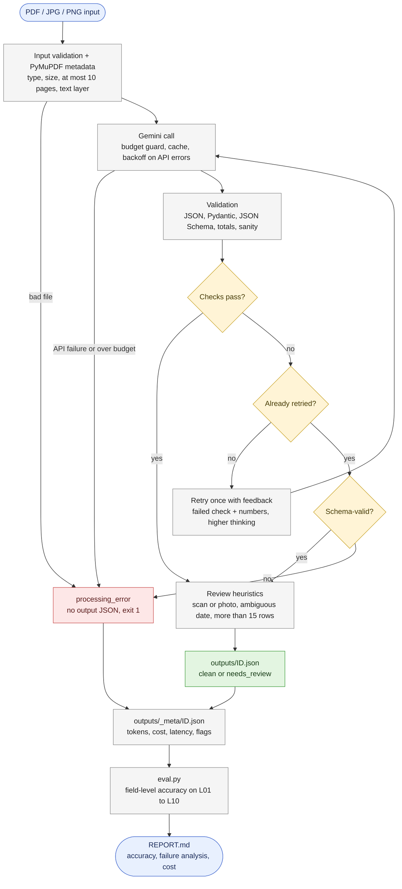

# Invoice Extractor

This pipeline reads one invoice and returns validated JSON that matches the assignment's `schema.json`. The input can be a digital PDF, a scan or a phone photo. If the document is not an invoice, it returns `is_invoice: false` and every other field is `null`.

What is included:

- `extract.py`: a CLI that extracts one document.
- `eval.py`: a one-command eval on the 10 labelled documents.
- `run_all.py`: writes outputs for all 20 sample documents.
- [REPORT.md](REPORT.md): accuracy, failure analysis and cost.

**Model:** Google `gemini-3.8-flash`. The original PDF or image is sent directly, so there is no separate OCR step. The unlabelled outputs (U01 to U10) came from `gemini-3.5-flash-lite`, because 3.8 Flash was overloaded during the final run. See REPORT.md Section 4.

## Setup

1. Clone the repo and move into it:
   ```bash
   git clone https://github.com/vgpatel124/Invoice-Extraction-Pipeline.git invoice-extractor
   ```
   ```bash
   cd invoice-extractor
   ```
2. Install [uv](https://docs.astral.sh/uv/) if you do not have it:
   ```bash
   curl -LsSf https://astral.sh/uv/install.sh | sh
   ```
3. Install the dependencies. uv also installs Python 3.12 if needed.
   ```bash
   uv sync
   ```
4. Create `.env` and add your Gemini API key (get one at https://aistudio.google.com/apikey):
   ```bash
   cp .env.example .env
   ```
   Then set `GEMINI_API_KEY=...` in `.env`.
5. Put the sample pack in `data/`. It is confidential, so it is not in the repo.
   ```
   data/
     labelled/     L01.pdf, L01.json, ... L10.pdf, L10.json
     unlabelled/   U01.pdf ... U10.pdf
   ```
   To use another folder, set `DATA_DIR` in `.env`.

**About the API key:**

- Use a key from a project with billing enabled for confidential documents. On the free tier, Google may use inputs to improve its products.
- The free tier allows only 20 requests per day per model, and it can be slow or overloaded. This submission was made on a free-tier key.
- The response cache (`.cache/`) is not in the repo. So the first `eval.py` run makes about 10 API calls (around $0.02 at paid prices). Later runs come from the cache and cost nothing.

**Without an API key**, you can still run the tests and the bad-input examples:
```bash
uv run pytest
```
```bash
uv run python extract.py tests/fixtures/not_an_image.jpg
```

## Usage

Extract one document. The JSON goes to stdout.
```bash
uv run python extract.py data/labelled/L01.pdf > out.json
```

Options:
- `--meta`: print `{"result": ..., "meta": ...}` with tokens, cost and validation details.
- `--no-cache`: force a fresh model call.
- `--model`: use a different model.

Run the eval on the labelled set. It prints the results tables and saves `eval_results/<model>_<prompt>_<mode>.json`.
```bash
uv run python eval.py
```

Useful flags:
- `--docs L01 L02`: run a subset.
- `--model gemini-3.5-flash-lite`: use the cheaper model.
- `--input-mode text`: send PyMuPDF text instead of the file (the experiment in the report).
- `--no-cache`: force fresh calls.

Regenerate `outputs/` for all 20 documents:
```bash
uv run python run_all.py
```

Frontend (bonus). Upload a document to see it on the left, with the extracted fields, checks, review reasons and cost on the right.
```bash
uv run --group ui streamlit run app.py
```

Tests and lint:
```bash
uv run pytest
```
```bash
uv run ruff check . && uv run ruff format --check .
```

## Pre-computed outputs

The outputs/ directory contains the extraction results generated for the 20 assignment documents.

Running `uv run python run_all.py` regenerates these outputs. Cached model responses are reused when available. Otherwise, new API requests are made.

The outputs/_meta/ directory contains execution metadata, including token usage, estimated cost, latency and review flags.

More details:
- `outputs/<ID>.json` holds only the 8 schema fields, because the schema has `additionalProperties: false`.
- The file is written only when extraction finished. If it failed, only `outputs/_meta/<ID>.json` exists, and its `processing_error` says why.
- `run_all.py` re-runs each document with the model saved in its `_meta` file, so the cache is used. Pass `--model` to use one model for all documents.

## How it works



1. **Input checks** (`src/inputs.py`), before any API call. The file must exist, have a supported extension, not be empty and be under 20 MB. Its first bytes must match the extension. A PDF must open, must not be password protected and must have at most 10 pages. An image must decode fully. PyMuPDF also records the page count and whether the PDF has a text layer.
2. **Model call** (`src/llm.py`). The file goes to Gemini with a system prompt that holds the labelling rules (`src/prompt.py`). The Pydantic model is passed as `response_schema`. Settings: thinking level `low`, default temperature, `max_output_tokens` 8192. Timeouts, 5xx errors and per-minute rate limits are retried with exponential backoff, 4 attempts in total.
3. **Validation** (`src/validate.py`):
   - the JSON parses;
   - Pydantic and JSON Schema (the official `schema.json`) pass;
   - line items + tax = total, within `max(0.02, 0.1% of total)`;
   - sanity checks: a real calendar date, finite amounts, total > 0, at least one line item.
4. **Retry once** if a check fails. The model is told which check failed and the numbers involved, and the thinking level goes up to `medium`. It is told to copy numbers as printed and never change them to make the totals add up.
5. **Decide** (`src/pipeline.py`), using the table below.
6. **Review flag** (`src/review.py`, bonus). A finished extraction gets `needs_review: true` in its metadata if any of these is true:
   - checks still fail after the retry;
   - the document is a scan or photo;
   - the day and month could be swapped, and the page text does not settle it;
   - there are more than 15 line items;
   - an invoice has empty header fields;
   - the answer is "not an invoice" on a document with no text layer.

   The reasons are listed in `review_reasons`. REPORT.md Section 6 measures how well the flag matches real errors.

## Failure behaviour

| Situation | Exit code | stdout | stderr | `outputs/<ID>.json` |
|---|---|---|---|---|
| Success | 0 | invoice JSON | empty | written |
| Totals or sanity check still failing after retry (output is schema-valid) | 0 | best schema-valid JSON | review warning | written; `needs_review: true` in meta |
| Output still schema-invalid after retry | 1 | empty | error JSON | not written; `processing_error` in meta |
| Corrupt, empty or unsupported file, or more than 10 pages | 1 | empty | error JSON | not written; `processing_error` in meta |
| API failure after backoff retries, or daily quota used up | 1 | empty | error JSON | not written; `processing_error` in meta |
| Budget would be exceeded | 1 | empty | error JSON | not written; `processing_error` in meta |

`needs_review` means the extraction finished but has doubts. `processing_error` means there is no extraction. The two are never set together. Invalid JSON is never printed as if it were valid.

## Bad-input handling

**Non-invoices (required).** The prompt defines an invoice and lists documents that are not invoices: purchase orders, quotations, bank statements, cover letters, delivery notes and contracts. For these, the model returns `is_invoice: false`. The schema check makes sure every other field is then `null`.

**Extra case chosen: corrupt, empty or unsupported files.** These are caught locally before any API call, so they cost nothing.

| Input | Error type |
|---|---|
| 0-byte file | `empty_file` |
| Truncated or damaged PDF, or an image that does not fully decode | `corrupt_file` |
| Wrong extension, or content that does not match it (for example a text file renamed to `.jpg`) | `unsupported_file` |
| Password-protected PDF | `unsupported_file` |
| PDF with more than 10 pages | `too_many_pages` |
| File over 20 MB | `file_too_large` |

Example:
```console
$ uv run python extract.py tests/fixtures/not_an_image.jpg; echo "exit=$?"
{
  "error": {
    "type": "unsupported_file",
    "message": "File content is not a PDF, JPEG or PNG"
  },
  "document": "not_an_image.jpg"
}
exit=1
```

The files in `tests/fixtures/` are generated by `uv run python tests/make_fixtures.py`. They are not from the sample pack.

**API problems are also handled.** Timeouts, 5xx errors and per-minute rate limits are retried with backoff. A free-tier daily quota error fails at once as `quota_exhausted`, because it will not recover within minutes.

## Cost control

- **Budget guard** (`src/budget.py`). `MAX_BUDGET_USD = 2.00`. Before every API call, retries included, the worst-case cost is estimated: input tokens from `count_tokens`, plus `max_output_tokens` at the output price. If that could go over the remaining budget, the call is refused with `budget_exceeded`. After the call, the real cost from the API's usage data is saved in `.cache/spend.json`.
- **Cache** (`src/cache.py`). Every model response is saved in `.cache/responses/`. The key covers the file hash, model, prompt version and text (including retry feedback), thinking level, temperature, output token limit and schema version. Re-running from the cache costs nothing.
- **Prices** are in `src/config.py`, with the source URL and the date they were checked. Thinking tokens are billed at the output price.

## Project structure

```
extract.py        CLI for one document
eval.py           one-command eval on the labelled set
run_all.py        writes outputs/ for all 20 documents
app.py            bonus Streamlit frontend
src/
  config.py       env loading, model ids, prices (with source and date)
  schema.py       Pydantic models + check against schema.json (src/schema.json)
  inputs.py       file loading and bad-input detection
  prompt.py       versioned prompts (PROMPT_VERSION)
  llm.py          the only provider call: timeout, backoff, structured output, usage
  validate.py     schema, totals and sanity checks
  pipeline.py     load, call, validate, retry once, decide
  review.py       needs_review heuristics
  cache.py        disk cache of model responses
  budget.py       spend cap and ledger
  matching.py     eval matching rules
outputs/          20 extraction JSONs, plus _meta/ per document
eval_results/     saved eval runs used in REPORT.md
tests/            pytest suite (validators, matching, bad inputs, retry logic, budget, cache)
```

`data/`, `.cache/`, `.env` and the sample documents are gitignored.
